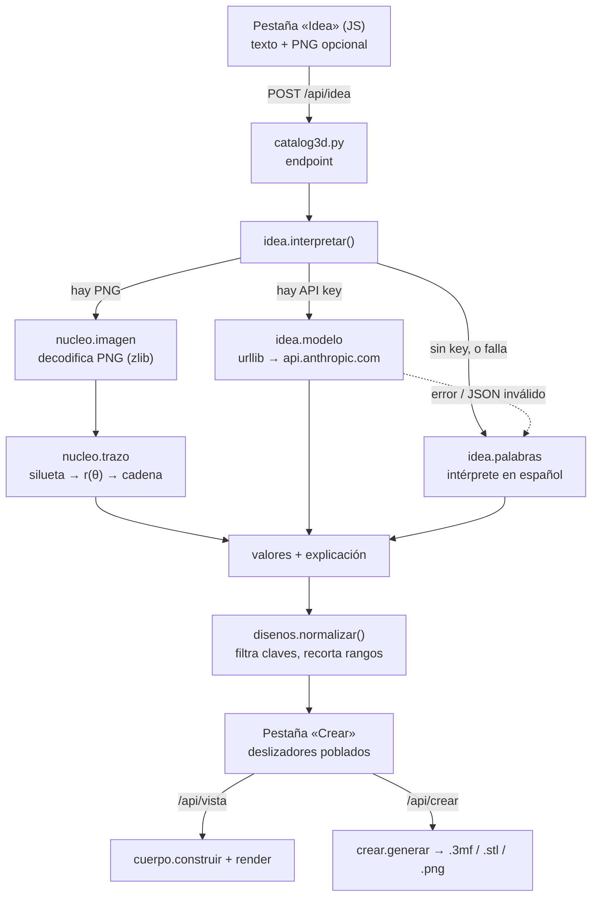

# Diseño — Pestaña «Idea»

## Overview

La idea rectora es que **nada de esto genera geometría**. Las tres vías de
entrada producen lo mismo: un diccionario de valores para `PARAMETROS`, más una
lista de por qués. Ese diccionario entra por `disenos.normalizar()` y de ahí en
adelante el camino es el que ya existe y está probado —`cuerpo.construir()`,
`render.render()`, `exportar.guardar_3mf()`—, sin ninguna ruta especial.

De ahí salen tres propiedades que valen más que cualquier otra decisión de este
documento:

- **Una idea mal entendida produce una pieza fea, nunca una no imprimible.**
  Los topes de pared, el recorte del relieve, el filete a 45° y los avisos de
  voladizo son del motor, y siguen valiendo aunque el texto de entrada sea un
  disparate.
- **El modelo elige valores, no escribe código.** Su salida es un JSON de pares
  clave/valor que se filtra contra las claves declaradas y se recorta a rango.
  El peor caso es un portalápices raro.
- **Agregar un parámetro al motor no obliga a tocar la pestaña Idea.** El prompt
  se genera desde `PARAMETROS` en tiempo de ejecución (R6.5).

La segunda decisión de fondo es cómo viaja una silueta trazada de una imagen.
No se guarda en un registro con sesión ni en disco: se **codifica dentro de los
propios valores**, como un parámetro más. Con eso, el trazo viaja gratis por
`/api/vista` y `/api/crear` tal como están, sobrevive un recargado de página y
no introduce estado de servidor (R4.3, R5.3).

## Architecture



Lo que hay que notar del diagrama: `normalizar()` es el cuello de botella por
donde pasa todo. Ninguna vía escribe en la malla, ninguna llama al motor por su
cuenta, y la pestaña «Crear» no distingue de dónde vinieron los valores.

## Components and Interfaces

### Módulos nuevos

| Archivo | Aprox. | Qué hace |
|---|---|---|
| `generadores/nucleo/imagen.py` | ~180 | PNG → matriz de píxeles, sólo con `zlib` y `struct` |
| `generadores/nucleo/trazo.py` | ~150 | Matriz → silueta → `r(θ)` → cadena codificada, y de vuelta |
| `generadores/idea/esquema.py` | ~70 | `PARAMETROS` → JSON Schema y catálogo en texto |
| `generadores/idea/modelo.py` | ~170 | Llamada a la API de Claude con `urllib` |
| `generadores/idea/palabras.py` | ~220 | Intérprete en español sin red |
| `generadores/idea/__init__.py` | ~110 | Orquesta las tres vías, arma la explicación |
| `generadores/pruebas.py` | ~200 | Pruebas con `unittest` de la librería estándar |

### Archivos que se tocan

| Archivo | Cambio |
|---|---|
| `nucleo/contornos.py` | Una entrada más en `CONTORNOS`: `"trazado"` |
| `disenos.py` | Tipo de parámetro `"trazo"`, el parámetro `trazo`, la receta `libre` |
| `catalog3d.py` | `GET /api/idea/estado`, `POST /api/idea`, y la pestaña en el HTML |

### `idea.interpretar(texto, receta, png_bytes=None)`

Único punto de entrada. Devuelve siempre la misma forma, gane quien gane:

```python
{
  "ok": True,
  "clave": "portalapices",       # receta de DISENOS donde aterriza
  "valores": {...},              # ya pasado por normalizar()
  "nombre": "PortacepillosPiedra",
  "via": "modelo" | "palabras",
  "explicacion": [
      {"clave": "contorno", "etiqueta": "Planta",
       "valor": "Guijarro", "porque": "«tipo piedra»"},
  ],
  "avisos": ["La silueta tiene entrantes que se van a perder."],
}
```

`explicacion` es lo que satisface R1.3 y R3.4 con un solo formato para las dos
vías. `valor` se muestra con su etiqueta legible, no con la clave interna.

Orden de resolución, que es donde vive la regla de precedencia de R4.8:

1. Si hay PNG, se traza y el resultado fija `contorno="trazado"`, `trazo=<cadena>`,
   y `ancho`/`fondo` en la proporción de la silueta.
2. Se interpreta el texto (modelo o palabras) sobre los valores de la receta base.
3. Los valores del texto se aplican **encima**, salvo `contorno` y `trazo` si
   vino una imagen: ahí manda la imagen.

### `idea.modelo` — la llamada por `urllib`

El proyecto prohíbe dependencias, así que se usa HTTP crudo en vez del SDK
`anthropic`. Es la excepción explícita: el SDK es lo normal en Python, y aquí no
cabe.

- **Endpoint**: `POST https://api.anthropic.com/v1/messages`
- **Cabeceras**: `x-api-key`, `anthropic-version: 2023-06-01`,
  `content-type: application/json`
- **Modelo**: `claude-opus-5`
- **`output_config`**: `{"effort": "low", "format": {"type": "json_schema", "schema": ...}}`.
  El esquema fuerza la forma de la respuesta, así que no hay que parsear prosa
  ni pelear con vallas de markdown. `effort: "low"` porque esto es extracción
  guiada por un esquema, no razonamiento: es la palanca de costo correcta, y no
  cambia de modelo.
- **`max_tokens`**: 2000. La respuesta son unas pocas decenas de pares.
- **Sin prefill, sin streaming**: la respuesta es corta y el prefill devuelve 400
  en los modelos actuales.

El esquema de salida es deliberadamente **una lista de ajustes**, no un objeto
con treinta propiedades opcionales:

```json
{
  "receta": "portalapices",
  "nombre": "Portacepillos de piedra",
  "ajustes": [
    {"clave": "contorno", "valor": "guijarro", "porque": "«tipo piedra»"},
    {"clave": "alto", "valor": "120", "porque": "«alto»"}
  ]
}
```

Tres razones para esa forma. Es un esquema chico y fijo, en vez de uno que crece
con cada parámetro. `porque` sale gratis y ya es la explicación que pide R1.3.
Y `valor` es siempre cadena: `normalizar()` ya hace `float()` con `try/except`
para los numéricos y compara por clave los de opción, así que las dos clases de
parámetro viajan por el mismo campo sin uniones de tipos en el esquema.

El catálogo de parámetros va en el `system`, generado por `esquema.catalogo()`
desde `PARAMETROS`: clave, etiqueta, rango o lista de opciones, y el texto de
`ayuda` —que ya está escrito para un humano y resulta ser exactamente el
contexto que el modelo necesita. Como es estable entre llamadas, se marca con
`cache_control: {"type": "ephemeral"}`; si el prefijo no alcanza el mínimo
cacheable, no cachea y no pasa nada. Se verifica mirando
`usage.cache_read_input_tokens`, no se da por hecho.

### `nucleo.trazo` — la silueta como `r(θ)`

Todos los contornos del motor están escritos como radio en función del ángulo, y
el piso se cierra en abanico desde el centro apoyándose en esa propiedad. Así que
la silueta trazada se guarda igual: **un arreglo de radios**, no un polígono.

No es sólo consistencia. Muestrear por ángulo **garantiza** que la forma sea
estrellada respecto del centro, que es justo lo que R4.4 teme perder. Lo que se
pierde son las concavidades profundas, y eso es medible: se compara el área del
borde trazado contra el área de la versión radial, y si la diferencia pasa del
5% se emite el aviso en vez de dejar que el fondo salga roto.

Pasos, todos en Python puro:

1. **Escalar** la imagen a 512 px de lado mayor, por muestreo de vecino más
   cercano. Acota el costo de todo lo que sigue.
2. **Separar figura de fondo**: si el PNG trae alfa, manda el alfa —es el caso
   real de un logo. Si no, umbral de Otsu sobre luminancia, y el fondo se decide
   por mayoría de las cuatro esquinas.
3. **Componente conexa mayor**: relleno por inundación iterativo con `deque`,
   nunca recursivo (una silueta de 512 px desborda la pila de Python).
4. **Centroide** de esa componente, y desde ahí 180 rayos: por cada ángulo, el
   último píxel de dentro. 180 × ~256 pasos ≈ 46 mil muestras, imperceptible.
5. **Suavizar** con media móvil circular de ventana 5 —circular, porque el
   contorno se cierra sobre sí mismo y una costura deja un escalón.
6. **Cuantizar** cada radio a 0–255 como fracción del radio máximo. Sobre una
   pieza de 70 mm, un paso vale 0.14 mm: por debajo de lo que imprime la máquina.

180 bytes → `zlib` → base64: entre 120 y 250 caracteres. Eso viaja sin problema
en el JSON de `/api/vista` cada 280 ms, que es el ritmo del debounce actual.

`contornos.trazado(p)` decodifica, interpola linealmente entre muestras y
reescala para llenar exactamente el `ancho` y el `fondo` pedidos, igual que
hacen las otras cuatro plantas no triviales. Si `contorno == "trazado"` pero
`trazo` viene vacío, devuelve el círculo y el motor agrega un aviso: degradar,
nunca reventar.

### `nucleo.imagen` — el decodificador de PNG

Es la parte más aburrida y la que más se puede equivocar, así que conviene
acotarla por escrito:

- **Se soporta**: profundidad de 8 bits, tipos de color 0 (gris), 2 (RGB),
  3 (paleta), 4 (gris+alfa) y 6 (RGBA), y los cinco filtros por fila
  (`None`, `Sub`, `Up`, `Average`, `Paeth`).
- **Profundidad de 16 bits**: se acepta quedándose con el byte alto.
- **Entrelazado Adam7**: se rechaza con un mensaje que dice qué hacer
  («vuelve a guardar el PNG sin entrelazar»), no con un error técnico.
- **No es PNG**: se rechaza nombrando el formato aceptado (R4.5). La firma se
  mira en los bytes, no en la extensión.
- **Tope de tamaño**: 8 MB de archivo y 4000 px de lado.

### `idea.palabras` — el intérprete sin red

Una tabla de reglas, cada una: un patrón, la clave que toca, y qué valor pone.

- **Formas y acabados** por su etiqueta en español, tomadas de `CONTORNOS`,
  `ACABADOS` y `PERFILES` en tiempo de ejecución más un puñado de sinónimos
  escritos a mano («piedra» → guijarro, «tela» → lino, «cañas» → junco).
- **Medidas explícitas**: `(\d+(?:[.,]\d+)?)\s*(mm|cm)` asociada al sustantivo
  más cercano de {alto, ancho, fondo, diámetro}.
- **Adjetivos relativos**: «alto», «bajo», «chico», «grande» como factor sobre
  el valor de la receta base, no como valor absoluto.
- **Conteos**: «tres ranuras», «dos filas», con los números del uno al ocho
  escritos con letra además de con dígito.
- **Presencias**: «con drenaje», «con bandeja», «sin divisiones».

La regla de precedencia de R3.2 se resuelve por orden: primero se aplican los
adjetivos relativos, después las medidas explícitas, que sobreescriben.

Si ninguna regla dispara, devuelve la receta base intacta y `explicacion` vacía,
y el orquestador convierte eso en el mensaje de R3.3.

### `catalog3d.py` — endpoints

| Ruta | Entrada | Salida |
|---|---|---|
| `GET /api/idea/estado` | — | `{"modelo": bool, "motivo": str}` |
| `POST /api/idea` | `{texto, receta, imagen}` | La forma de `interpretar()` |

`imagen` es un data URL base64 que el navegador arma con `FileReader`. Se
rechaza arriba de 8 MB antes de decodificar nada. El trazo se memoiza en un
diccionario por hash SHA-256 de los bytes, con tope de 8 entradas, para que
reescribir el texto no vuelva a trazar la misma imagen.

`POST /api/idea` se suma a la lista blanca de rutas de `do_POST` y comparte el
guardia de `HAY_GENERADORES` que ya usan `/api/vista` y `/api/crear`.

### La receta `libre`

`generar_diseno()` exige `clave in POR_CLAVE`, y no conviene tocarlo. Así que se
agrega una cuarta entrada a `DISENOS`:

```python
{"clave": "libre", "nombre": "Pieza libre",
 "descripcion": "Lo que salga de una idea.", "carpeta": "Ideas",
 "valores": {}}
```

Con eso, «que lo decida la idea» (R1.1) tiene dónde aterrizar, las piezas
nacidas de una descripción caen en su propia subcarpeta, y `generar_diseno`,
`nombre_sugerido` y el guardado siguen exactamente igual.

### La interfaz

La pestaña «Idea» es deliberadamente flaca: un `textarea`, un selector de
receta base, un `input file` para el PNG, un botón, y debajo la lista de lo que
se entendió. El botón «Ajustar en Crear» copia `crValores`, llama a
`dibujarControles()` y `pedirVista()`, y cambia de pestaña — o sea, reusa las
funciones que ya existen sin tocarlas.

El parámetro `trazo` no se dibuja como deslizador: `dibujarControles()` salta el
tipo `"trazo"` y en su lugar la pestaña muestra la miniatura de la silueta con
un botón para quitarla (lo que devuelve el contorno a `circulo`).

R5.5 —avisar antes de descartar ajustes manuales— se resuelve con una bandera
`crTocado`, que se prende en el `input` de cualquier control y se apaga al
poblar desde una idea. Con la bandera prendida, interpretar de nuevo pide
confirmación.

## Data Models

### El parámetro `trazo`

Un tipo nuevo en la declaración, para que la interfaz y `normalizar()` sepan qué
hacer con él sin casos especiales regados:

```python
def trazo(clave, etiqueta, grupo="Forma"):
    return {"clave": clave, "etiqueta": etiqueta, "tipo": "trazo",
            "valor": "", "unidad": "", "grupo": grupo,
            "depende": ["trazado"], "ayuda": "La silueta sacada de una imagen."}
```

Y la rama correspondiente en `normalizar()`:

```python
elif spec["tipo"] == "trazo":
    v = entrada[c]
    if isinstance(v, str) and len(v) <= 4096 and _BASE64.fullmatch(v):
        p[c] = v
```

La validación es la que importa: sólo base64, con tope de largo. Lo que entra
por ahí termina en `zlib.decompress`, así que se acota antes.

### Formato codificado del trazo

`base64(zlib(b"T1" + bytes([r_0, ..., r_179])))`

La marca `T1` de dos bytes es la versión. Un trazo de una versión que no se
conozca se ignora con aviso, en vez de decodificarse mal.

### Configuración

`~/.catalog3d/config.json`, con permisos 600:

```json
{"api_key": "sk-ant-..."}
```

Precedencia: `ANTHROPIC_API_KEY` del entorno primero, el archivo después. El
directorio no está en el repositorio y por lo tanto no hay nada que agregar a
`.gitignore` (R2.7). La clave nunca se manda al navegador: `/api/idea/estado`
sólo dice si hay una, no cuál.

## Error Handling

La regla general: **degradar, no fallar**. Cada escalón de abajo entrega algo
utilizable.

| Falla | Qué hace | Requisito |
|---|---|---|
| Texto vacío | Se rechaza en el navegador, sin tocar la red | R1.4 |
| No hay API key | Va directo a `palabras`, y lo dice | R2.8 |
| HTTP 401 | Un aviso de que la clave no sirve, y `palabras` | R2.5 |
| HTTP 429 o 5xx | Un reintento con espera, después `palabras` | R2.5 |
| `URLError` / sin red | `palabras`, sin reintento | R2.5 |
| Tiempo agotado (20 s) | Se abandona y se usa `palabras` | R2.6 |
| JSON inválido | Un reintento, después `palabras` | R2.5 |
| `stop_reason: "refusal"` | Se trata como respuesta vacía → `palabras` | R2.5 |
| Clave desconocida en la respuesta | Se descarta en silencio | R2.3 |
| Valor fuera de rango | `normalizar()` lo recorta | R2.4 |
| No es PNG | Mensaje que nombra el formato aceptado | R4.5 |
| PNG entrelazado | Mensaje que dice cómo volver a guardarlo | R4.5 |
| Sin figura distinguible | Se avisa y la planta queda como estaba | R4.6 |
| Silueta con entrantes hondos | Se avisa, se traza igual | R4.4 |
| `trazo` vacío con contorno trazado | Vuelve al círculo, con aviso | R6.4 |

Un detalle que no es obvio: `interpretar()` **nunca lanza** hacia el endpoint.
Devuelve `ok: False` con un mensaje en español, o `ok: True` con avisos. El
`try/except` que ya envuelve `/api/vista` y `/api/crear` queda como red de
seguridad, no como el mecanismo.

## Testing Strategy

El proyecto no tiene pruebas hoy. Se agrega `generadores/pruebas.py` con
`unittest`, que es de la librería estándar y se corre con
`python3 -m unittest generadores.pruebas`. Sin fixtures binarios en el
repositorio: las imágenes de prueba se **sintetizan** con
`render.escribir_png()`, que ya existe.

**Trazo (ida y vuelta).** Se escribe un PNG con un círculo negro sobre blanco,
se traza, y se verifica que los 180 radios queden dentro del 2% entre sí. Con
una elipse, que la razón de semiejes salga a menos del 3%. Con un cuadrado, que
las esquinas den √2 veces el radio de los lados.

**Recorte y degradación.** Que un `trazo` corrupto no lance; que un `trazo`
vacío con `contorno="trazado"` dé el círculo; que un base64 de 5000 caracteres
sea rechazado por `normalizar()`.

**PNG.** Un caso por tipo de color y por filtro de fila. El de filtros importa
más de lo que parece: `Paeth` mal implementado da una imagen que se ve casi
bien y una silueta que no.

**Palabras.** Una tabla de frase → clave/valor esperado, incluyendo el caso de
R3.2 («un vaso alto de 60 mm» debe dar 60, no el factor de «alto») y el de R3.3
(texto sin nada reconocible).

**Modelo, sin red.** Se prueba `esquema.py` —que el JSON Schema salga válido
para todo `PARAMETROS`— y el parseo de respuestas con un doble que devuelve
cuerpos guardados como texto: respuesta buena, JSON truncado, clave inventada,
valor fuera de rango, `refusal`. **Ninguna prueba llama a la API**; el
transporte se inyecta.

**Que no se rompa lo de antes (R6.3).** Para cada receta de `DISENOS`, se
construye la malla y se comparan vértices, triángulos y gramos contra los
valores de antes del cambio. Es la prueba que justifica todo lo demás.

## CICD Integration Strategy

No hay CI: es una herramienta local de un solo usuario, sin `package.json`, sin
workflows, sin despliegue. Meter un pipeline aquí sería infraestructura sin
nadie a quien servir.

Lo que sí corresponde:

- `python3 -m unittest generadores.pruebas` corre en frío, sin red y sin API
  key. Todas las pruebas que tocarían la red están inyectadas.
- El `README.md` gana una sección de la pestaña «Idea» y una línea sobre dónde
  va la API key, en el tono del resto del documento.
- Se sigue trabajando en `feat/bambu-studio-y-acciones-en-lote` o en una rama
  propia, con la misma cadencia de commits que el repositorio ya trae.
- Nada de esto cambia el arranque: `python3 catalog3d.py` sigue siendo el
  contrato, sin variables de entorno obligatorias (R6.2).
