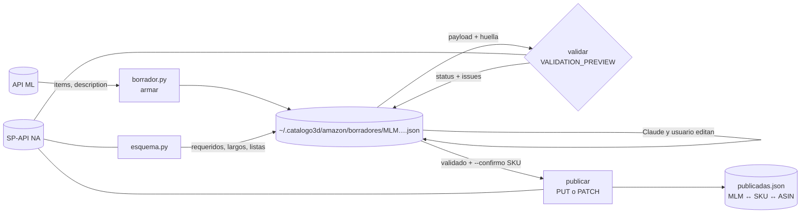

# Diseño — Publicador MercadoLibre → Amazon México

## Resumen

Un skill nuevo, `publicar-amazon`, con un script de línea de comandos que
trabaja por **borradores**: por cada publicación activa de ML (o cada
variación) arma un JSON en `~/.catalogo3d/amazon/borradores/` con todo lo que
irá a Amazon. El script hace la parte mecánica: lee ML, limpia el título,
saca viñetas de la descripción, convierte fotos a tamaño completo, propone el
tipo de producto, compara contra el esquema de Amazon, valida con
`VALIDATION_PREVIEW` y publica. La redacción fina (un título como el de la
ficha del Olas, viñetas con gancho) la hacen Claude y el usuario en la sesión,
editando el borrador. El script respeta esas ediciones.

Lo que ordena el diseño es una **huella** (sha256 del contenido que se
mandaría a Amazon). Una validación vale solo para la huella con la que se
hizo: si cambia cualquier cosa del borrador, el estado vuelve a «borrador»
sin que nadie lo tenga que recordar (Req. 8.3–8.4). Y la aprobación para
publicar no es una pregunta interactiva, porque en este taller los comandos
los corre Claude, que no puede contestar un `input()`. Es una bandera
`--confirmo <SKU>` que debe repetir el SKU exacto, y Claude solo la pone
después del «sí» del usuario en el chat (Req. 9).

### Lo que se investigó

- **ML ya tiene cliente**: `.claude/skills/colecta-full/scripts/ml_api.py`
  (token con renovación, permisos 600) y `traer_datos.py`
  (`listar_publicaciones`, `detalle_publicaciones` en multiget de 20). Se
  reusan importándolos, no se copian (Req. 2.2).
- `~/.catalogo3d/ml_datos.json` solo guarda un resumen (título, precio,
  estado), no atributos ni fotos. El publicador pide `/items/{id}` y
  `/items/{id}/description` en vivo.
- **El Olas en la API de ML** (MLM3674350731, leído el 2026-10-25): categoría
  MLM190943 (`MLM-FLATWARE_ORGANIZERS`), atributos `BRAND=Savia Raiz` (sin
  acento), `COLOR`, `MATERIAL=PLA`, `COMPARTMENTS_NUMBER`, `WIDTH/DEPTH/HEIGHT`
  (WIDTH=8 cm está mal: el largo real es 19.6), `SELLER_PACKAGE_*` (20×16×11
  cm, 198 g). No trae peso del artículo ni GTIN. La descripción tiene
  secciones en mayúsculas: `INCLUYE OBSEQUIO DE SIEMBRA`, `CARACTERÍSTICAS`,
  `CUIDADOS`, `IMPORTANTE`, y cierra con «¿Tienes dudas?» y «¿Necesitas
  factura?».
- **Las 40 activas**: 9 categorías de ML (10 portacontroles, 7
  portacubiertos, 5 portacepillos, 5 portalápices, 5 decoración, 4 floreros,
  2 macetas, 1 escultura, 1 organizador de fregadero). 5 tienen variaciones
  (2–3 cada una). Ninguna tiene GTIN. Tienen entre 2 y 12 fotos.
- **Fotos**: la URL que da la API termina en `-O.jpg` y mide 500 px. Con
  `-F.jpg` la misma foto sale a 1200 px (comprobado). mlstatic responde 405 a
  `HEAD`, así que la verificación se hace con `GET` + `Range` y leyendo el
  tamaño del encabezado JPEG/WebP.
- **Peso de la pieza y costo**: `~/Desktop/own design 3d/.catalogo3d_mercadolibre.json`
  liga cada `.3mf` con su MLM (dentro de `link`) y su `peso_g`;
  `.catalogo3d_costos.json` da `precio_kg` y el paquete activo.
- **SP-API** (modelos oficiales en `amzn/selling-partner-api-models`):
  - `PUT|PATCH|GET /listings/2021-08-01/items/{sellerId}/{sku}` con
    `marketplaceIds`, `mode=VALIDATION_PREVIEW` (solo en PUT y PATCH),
    `includedData` e `issueLocale`. La respuesta trae `status`
    (`ACCEPTED`/`INVALID`/`VALID`) e `issues[]` con `code`, `message`,
    `severity`, `attributeNames`. Límite de 5 peticiones por segundo.
  - `GET /definitions/2020-09-01/productTypes?keywords|itemName&marketplaceIds&locale`
    busca tipos; `GET /definitions/2020-09-01/productTypes/{pt}?sellerId&marketplaceIds&requirements=LISTING&locale=es_MX`
    da `productTypeVersion` y `schema.link` (JSON Schema descargable).
  - Desde 2023 basta el access token de LWA en `x-amz-access-token`: no hace
    falta firmar con AWS SigV4, así que alcanza con `urllib`.
  - El nombre del atributo de exención de GTIN
    (`supplier_declared_has_product_identifier_exemption` según terceros) se
    toma del esquema, no se escribe a mano.

### El Olas publicado a mano (leído por SP-API el 2026-10-26)

Las credenciales ya funcionan. Así quedó el Olas en Amazon:

- SKU **`5Z-W3LH-N087`** (lo generó Amazon; no es el `SR-PCUB-OLAS-NEG` de la
  ficha), ASIN **B0HP8CH8LT**, estado `DISCOVERABLE` y `BUYABLE`, sin issues.
- Tipo de producto **`CADDY`** («Caddy»), nodo de navegación 9725275011.
  Obligatorios del esquema: `brand`, `bullet_point`, `country_of_origin`,
  `item_name`, `product_description`, `supplier_declared_dg_hz_regulation`
  (y las condicionales). `item_name` admite hasta 200 caracteres. Todos los
  textos van con `language_tag: es_MX`.
- **Marca `Generic`** y fabricante «Genérico», con
  `supplier_declared_has_product_identifier_exemption: true`. Así Amazon lo
  aceptó sin GTIN y sin tramitar exención para Savia Raíz.
- El título se quedó como en ML («…Olas Más Obsequios»),
  `title_differentiation` dice «Incluye Obsequios» e `included_components`
  dice «portacubierto y regalo». Amazon no lo frenó.
- **Datos equivocados**, posiblemente autocompletados: color «Plateado» (es
  negro), `item_weight` 450 g (pesa 105), `item_package_weight` 500 g (es
  198), `number_of_compartments` 6 (son 3), `capacity` 2.5 L. El peso del
  paquete es justo lo que Amazon usa para cobrar FBA. Las medidas del
  artículo (19.6 × 7.8 × 10.2) sí están bien.
- Fotos subidas a `m.media-amazon.com` (1 principal + 4); envío propio
  (`DEFAULT`, 10 piezas, `merchant_shipping_group: legacy-template-id`);
  precio $209 con mínimo 189 y máximo 249.
- Las dimensiones del artículo en `CADDY` van en `item_depth_width_height`.
  Otros tipos usan otro nombre, así que se lee del esquema.

Esto le da al diseño una **plantilla real** para `CADDY` y dice qué otros
atributos llena Amazon (`item_shape`, `mounting_type`, `special_feature`,
`specific_uses_for_product`, `number_of_items`, `unit_count`,
`supplier_declared_dg_hz_regulation: not_applicable`). El publicador los
propone y quedan «por revisar» cuando no salen de ML.

## Arquitectura

```
.claude/skills/publicar-amazon/
  SKILL.md               cómo usarlo desde la sesión (flujo y reglas)
  categorias.json        mapeo categoría ML → tipo de producto + clave SKU (se versiona)
  scripts/
    sp_api.py            LWA + peticiones a SP-API, reintentos, sin secretos
    esquema.py           buscar tipo, bajar/cachear esquema, revisar borrador
    borrador.py          ML → borrador; reglas de Amazon; huella; borrador → payload
    publicar.py          línea de comandos
    prueba_publicar.py   pruebas sin red
```



## Componentes e interfaces

### `sp_api.py`

- `cargar_credenciales()` lee `~/.catalogo3d/amazon_credenciales.json`:
  `{"client_id", "client_secret", "refresh_token", "seller_id"}`. El
  `seller_id` es el «Identificador de comerciante» de Seller Central
  (Configuración → Información de la cuenta). No es secreto, pero tampoco va
  al repo. Si el archivo no existe, explica los pasos de la app privada y los
  roles (Req. 1.3). Si `stat.S_IMODE(mode) & 0o077` no es cero, se niega a
  usarlo y da el `chmod 600` (Req. 1.4).
- `_access_token()`: `POST https://api.amazon.com/auth/o2/token` con
  `grant_type=refresh_token`. Lo guarda **solo en memoria** con su
  vencimiento (−120 s) y lo renueva solo (Req. 1.6). No se escribe a disco: el
  refresh token de LWA no rota, así que no hay nada nuevo que guardar.
- `pedir(metodo, ruta, params=None, cuerpo=None)`: host
  `https://sellingpartnerapi-na.amazon.com`, encabezado `x-amz-access-token`.
  Con 429 o 5xx reintenta hasta 5 veces con espera 1-2-4-8-16 s; con 401/403
  renueva el token una vez (Req. 8.5). Entre llamadas espera 0.25 s.
- `ErrorSP(Exception)`: el mensaje lleva método, ruta y cuerpo de la
  respuesta, pero pasa por `_tapar()`, que reemplaza con `***` cualquier
  aparición de los valores de las credenciales y de los tokens vigentes. Los
  encabezados nunca se imprimen (Req. 1.5).
- `MARKETPLACE = "A1AM78C64UM0Y8"`, `LOCALE = "es_MX"`.

### `esquema.py`

- `buscar_tipos(palabras)` → `searchDefinitionsProductTypes` con
  `keywords`, `locale=es_MX`. Devuelve nombre y `displayName` (Req. 5.1).
- `esquema(tipo)`: llama a `getDefinitionsProductType` (una vez por tipo y
  corrida). Si su `productTypeVersion.version` coincide con la de
  `~/.catalogo3d/amazon/esquemas/<tipo>.json`, usa la caché; si no, baja
  `schema.link.resource` y la reemplaza (Req. 5.5).
- `revisar(atributos, esquema)` → lista de hallazgos `{campo, tipo, detalle}`,
  sin red. Recibe los atributos ya en forma de Amazon (los de `payload()`),
  así revisa exactamente lo que se mandaría; con el Olas real da 0 errores:
  - obligatorios del `required` raíz sin valor (Req. 5.3). Las reglas
    condicionales (`allOf/if/then`) no se reimplementan: las reporta Amazon
    en la validación;
  - `maxLength` / `maxItems` / `minLength` de `properties.<attr>.items.properties.value`
    (Req. 4.2);
  - valores fuera de `enum` (Req. 5.4): error si la lista es cerrada
    (`enum`), aviso si es sugerida (`anyOf` con texto libre);
  - atributos que el tipo no tiene (`additionalProperties: false`) y
    subcampos requeridos (`language_tag`, `unit`…).
- `valor_mas_cercano(texto, enum, enumNames)`: normaliza (minúsculas, sin
  acentos) y busca primero igualdad y luego contención en un solo sentido.
  Si hay 0 o 2+ candidatos, devuelve `None` y el campo queda «por revisar».
- `atributo_exencion(esquema)`: el nombre de la propiedad que contiene
  `product_identifier_exemption`.

### `borrador.py` (funciones puras más dos lecturas de ML)

- `armar(item, descripcion, variacion=None, mapeo, pesos, costos)` → dict de
  borrador nuevo (ver Datos). Aquí viven las reglas:
  - **Título** (Req. 4.1): quita frases con
    `r"\b(m[aá]s\s+)?(obsequios?|regalos?(\s+sorpresa)?)(\s+de\s+(cultivo|siembra))?\b"`,
    `gratis`, `env[ií]o gratis`, `oferta`, `promoci[oó]n`, `descuento`,
    `m[aá]s vendido`, `ll[eé]vatelo`; quita los caracteres `! $ ? _ { } ^ ¬ ¦`;
    pone la marca al principio si no está (solo si la marca no es
    `Generic`: un título con otra marca que la del campo `brand` se ve como
    marca falsa) y colapsa espacios. Guarda en
    `avisos` qué quitó.
  - **Secciones de la descripción**: parte el texto en bloques por líneas en
    MAYÚSCULAS. Descarta las secciones del obsequio («INCLUYE REGALO
    SORPRESA», «INCLUYE OBSEQUIO DE SIEMBRA/CULTIVO…»), las frases que lo
    prometen («recibes una maceta pequeña, humus y semillas», «regalo
    sorpresa») y el cierre de ML (`¿Tienes dudas?`, `¿Necesitas factura?`).
    Avisa que el kit es posiblemente restringido (Req. 4.3). «IDEAL PARA
    REGALAR» se queda: sugiere ocasión, no promete nada. «Maceta» sola no
    cuenta: en macetas y floreros es el producto mismo. Los dos «Kit Maceta»
    (el kit es el producto) no pierden nada y llevan el aviso de restringido.
  - **Viñetas** (Req. 3.4): hasta 5, de los bloques que quedan: primer
    párrafo, `CARACTERÍSTICAS` (renglones `- …` juntos), `CUIDADOS`,
    `IMPORTANTE` y una de medidas armada con las medidas del borrador.
  - **Descripción**: los mismos bloques limpios, cortados al `maxLength` del
    esquema.
  - **Palabras clave**: palabras de título y categoría que no están en el
    título final, sin repetir, hasta 249 bytes, separadas por espacio.
  - **Fotos** (Req. 2.3): `http→https`, `-[A-Z]\.(jpg|webp)$ → -F.jpg`, en el
    orden de ML (las de la variación, si hay). Principal = la primera; las
    demás, hasta 8. Si sobran, avisa.
  - **SKU** (Req. 3.3): `SR-<clave de categorias.json>-<NOMBRE>-<COLOR3>`.
    NOMBRE es la primera palabra del título limpio que no es genérica (lista
    corta: organizador, porta…, de, control, remoto, diseño, moderno…) ni
    color, en mayúsculas y sin acentos; si no hay ninguna, los últimos 4
    dígitos del MLM (`SR-PCON-6256-NEG`). COLOR3 son las 3 primeras letras
    del color. Si choca con otro borrador, agrega `-2`. Si la publicación
    ya está en `publicadas.json`, usa ese SKU.
  - **Medidas** (Req. 3.6): artículo como `frente/fondo/alto` (frente =
    `LENGTH` o, si no hay, `WIDTH`; fondo = `DEPTH` o `WIDTH`); paquete de
    `SELLER_PACKAGE_*` ordenado de mayor a menor; peso del artículo de
    `peso_g` (el catálogo solo liga 2 de las 40 publicaciones con su MLM, así
    que casi siempre queda por llenar). Todo en cm y g. Si el paquete pesa
    más de 600 g, aviso: en ML hay paquetes de 1–1.6 kg para piezas de
    ~130 g, y Amazon cobra FBA por ese peso.
  - **Precio** (Req. 3.5): `original_price` si existe (las promos SMART bajan
    `price`), si no `price`. Al lado, el costo con la fórmula del catálogo,
    marcado «costo como en ML» porque incluye la paquetería del kit.
  - **Material**: `PLA` → «Plástico» (la lista de `CADDY` no tiene PLA; el
    Olas quedó así).
  - **Atributos simples** desde ML: `brand` y `manufacturer` salen de
    `marca` en `categorias.json` (ver Decisiones: `Generic` como el Olas, o
    «Savia Raíz» con exención tramitada), `color`, `material`, `number_of_compartments` (si el
    esquema lo tiene), `country_of_origin=MX`, `condition_type=new_new`,
    `item_type_keyword` / `recommended_browse_nodes` si el esquema los pide
    (quedan «por revisar»).
- `por_revisar` inicial: `tipo_producto` (si la categoría no está
  confirmada), `titulo`, `vinetas`, `palabras_clave`, `precio`, `envio`,
  `foto_principal`, `medidas` y cada atributo obligatorio sin valor o sin
  enum claro.
- `huella(borrador)` = sha256, en JSON canónico (`sort_keys`, sin espacios),
  de los campos de contenido del borrador (SKU, tipo, título, viñetas,
  descripción, palabras clave, atributos, medidas, fotos, precio, envío). No
  depende del esquema, así que una versión nueva del tipo no invalida sola
  una validación; los avisos y `por_revisar` no cuentan.
- `payload(borrador, esquema)` → `{"productType", "requirements": "LISTING",
  "attributes"}`. Expande cada valor simple a la forma de Amazon, poniendo
  `marketplace_id` y `language_tag` solo donde el esquema del atributo los
  declara. Lo que el borrador ya trae como lista de dicts se pasa tal cual.
  Agrega:
  - `purchasable_offer`: `[{"currency": "MXN", "our_price": [{"schedule": [{"value_with_tax": P}]}], "marketplace_id": …}]`;
  - `fulfillment_availability`: FBA → `[{"fulfillment_channel_code": "AMAZON_NA"}]`,
    propio → `[{"fulfillment_channel_code": "DEFAULT", "quantity": N}]` (Req. 7);
  - `main_product_image_locator` y `other_product_image_locator_1..8` con
    `media_location`;
  - la exención de GTIN en `true` cuando no hay GTIN (Req. 4.8).
- `cambios_en_ml(borrador, item)`: compara `origen_ml` (título, precio,
  lista de fotos) con ML hoy (Req. 3.2).
- `fotos_ok(urls)`: `GET` con `Range: bytes=0-65535`, revisa que el
  `Content-Type` sea imagen y lee ancho×alto del encabezado (SOF de JPEG o
  VP8 de WebP). Avisa si el lado mayor es menor a 1000 px (Req. 4.5).

### `publicar.py` — comandos

| Comando | Qué hace | Red |
|---|---|---|
| `lista` | activas de ML + estado de cada borrador (sin borrador / borrador / validado / publicado), variaciones señaladas (Req. 2.1, 6.1) | ML |
| `armar MLM… [--todas]` | crea los borradores que falten; en los que existen, solo reporta cambios en ML (Req. 3.1–3.2, 6.1) | ML, SP |
| `ver MLM…` | muestra el borrador legible: medidas juntas, `por_revisar`, avisos, hallazgos del esquema (Req. 3.6) | SP (esquema) |
| `aprobar MLM… campo [campo…]` | quita campos de `por_revisar` | — |
| `validar MLM…` | `revisar()` local; si no hay errores locales, PUT con `VALIDATION_PREVIEW`, `includedData=issues,identifiers`, `issueLocale=es_MX`; guarda resultado y huella (Req. 8) | SP |
| `comparar MLM… [--sku S]` | GET del SKU en Amazon (`summaries,attributes,issues,offers,fulfillmentAvailability,productTypes`) y tabla lado a lado contra el borrador; no escribe nada (Req. 10.2) | SP |
| `publicar MLM [--confirmo SKU] [--campos a,b]` | ver abajo (Req. 9) | SP |
| `estado MLM…` | GET del SKU publicado: ASIN, estado, issues; si un issue habla de la imagen principal, lo resalta (Req. 4.6, 9.5) | SP |

`MLM…` acepta `MLM123` o `MLM123-<variación>` para una variación.

**`publicar`**:
1. Exige estado «validado» con huella vigente y `por_revisar` vacío (Req. 9.1).
2. GET del SKU. Si no existe, muestra el resumen (SKU, título, precio,
   envío, foto principal). Sin `--confirmo` se detiene ahí. Con
   `--confirmo` igual al SKU hace PUT sin `mode` (Req. 9.2).
3. Si el SKU ya existe, muestra la diferencia por atributo. Solo con
   `--campos` y `--confirmo` manda un PATCH con `op: replace` de esos
   atributos, primero en `VALIDATION_PREVIEW` y luego de verdad (Req. 9.4).
4. Una publicación por comando: no hay `--todas` en `publicar` (Req. 9.3).
5. Si la respuesta es `ACCEPTED`, escribe en `publicadas.json` (Req. 9.5).
   El ASIN llega después: `estado` lo completa.

Si la terminal es interactiva (`sys.stdin.isatty()`) y falta `--confirmo`,
pregunta «Escribe el SKU para publicar». Así el usuario también puede
correrlo por su cuenta.

### `SKILL.md`

Explica el flujo en la sesión: `armar` → Claude mejora título y viñetas en
el borrador (con las reglas de la ficha del Olas) → `ver` → el usuario
aprueba campos → `validar` → `publicar` sin `--confirmo` → «sí» del usuario
en el chat → `publicar --confirmo SKU`. Dice explícitamente que Claude
**nunca** pone `--confirmo` sin ese «sí» de esa publicación. Se agrega a la
tabla de skills de `CLAUDE.md`.

## Datos

Todo bajo `~/.catalogo3d/amazon/` (carpeta 700, archivos 600), salvo
`categorias.json`.

**Borrador** `borradores/MLM3674350731.json`:

```json
{
  "mlm": "MLM3674350731", "variacion": null,
  "sku": "SR-PCUB-OLAS-NEG",
  "tipo_producto": "…",
  "titulo": "Savia Raíz Organizador De Cubiertos Olas Negro",
  "vinetas": ["…"], "descripcion": "…", "palabras_clave": "…",
  "atributos": {"brand": "Savia Raíz", "color": "Negro", "material": "PLA", "…": "…"},
  "medidas": {"articulo": {"largo": 8, "ancho": 8, "alto": 10, "peso_g": 105.1},
              "paquete": {"largo": 20, "ancho": 16, "alto": 11, "peso_g": 198}},
  "fotos": {"principal": "https://http2.mlstatic.com/D_870085-…-F.jpg",
            "otras": ["…"], "excluidas": []},
  "precio": 209, "costo_ref": 33.93,
  "envio": {"modo": null, "cantidad": null},
  "por_revisar": ["titulo", "vinetas", "precio", "envio", "foto_principal", "medidas"],
  "avisos": ["Quité del título: «Más Obsequios»", "Kit de siembra fuera: posiblemente restringido"],
  "origen_ml": {"titulo": "…", "precio": 209, "fotos": ["…"], "leido": "2026-10-25"},
  "validacion": {"fecha": "…", "huella": "…", "status": "VALID", "issues": []},
  "publicado": null
}
```

`atributos` usa los nombres de Amazon. Un valor simple (texto o número) se
expande en `payload()`; una lista de dicts va tal cual (para dimensiones u
otras estructuras que el esquema pida). El estado no se guarda: se deduce
(`publicado` → publicado; `validacion.huella == huella()` y `status VALID` →
validado; si no, borrador).

**`categorias.json`** (versionado, no tiene nada del negocio):
`{"MLM190943": {"tipo_producto": "…", "clave_sku": "PCUB", "confirmado": false}, …}`.
Arranca con las 9 categorías y su clave (PCON, PCUB, PCEP, PLAP, DECO, FLOR,
MACE, ESCU, FREG), más una clave global `marca`. El tipo de producto se llena
con `armar` y el usuario lo confirma una vez por categoría (Req. 5.2).
MLM190943 ya entra como `CADDY` confirmado, porque así está el Olas.

**`publicadas.json`**: `{"5Z-W3LH-N087": {"mlm", "variacion", "asin", "fecha", "precio", "submission_id"}}`.
Arranca con el Olas (`MLM3674350731` ↔ `5Z-W3LH-N087` ↔ `B0HP8CH8LT`), así
`armar` reconoce que ya está publicado y usa su SKU en lugar de inventar
otro (Req. 3.3, 9.4).

**`esquemas/<tipo>.json`**: `{"version", "bajado", "esquema"}`.

## Errores

| Qué falla | Qué ve el usuario |
|---|---|
| Falta `amazon_credenciales.json` | Los campos que lleva y los pasos en Seller Central; nada de pegar en el chat |
| Permisos ≠ 600 | «Corre `chmod 600 ~/.catalogo3d/amazon_credenciales.json`» y se detiene |
| LWA rechaza el refresh token | «Autoriza la app otra vez en Seller Central», sin el cuerpo con datos |
| ML caído o token de ML inválido | El error de `ml_api` y alto, antes de escribir borradores (Req. 2.4) |
| 429 / 5xx de Amazon | Reintentos con espera; si se agotan, se detiene en esa publicación y las ya hechas quedan guardadas |
| `INVALID` en la validación | Cada issue: severidad, atributo y mensaje en español; queda en el borrador |
| Issue de exención de GTIN (atributo de identificador o mensaje con «GTIN/exención») | «La marca <marca> no tiene exención para este tipo: se tramita en Seller Central → Exención de GTIN». No reintenta (Req. 4.8) |
| Foto que no responde o mide < 1000 px | Aviso con la URL; no bloquea validar |
| Borrador editado a mano con JSON roto | Archivo y línea del error; no lo sobrescribe |
| Cambió ML después del borrador | Diferencias campo por campo; el borrador no se toca (Req. 3.2) |

## Pruebas

`scripts/prueba_publicar.py`, sin red, con el estilo de
`colecta-full/scripts/prueba_traer_datos.py`. Usa un ítem de ML de muestra:
la ficha pública del Olas recortada (título, atributos, 5 fotos,
descripción), escrita en el archivo de prueba, y un esquema mínimo hecho a
mano con `required`, `maxLength`, `enum` y `language_tag`.

- El título del Olas pierde «Más Obsequios» (y gana la marca solo si no es
  `Generic`); los de las
  variaciones reales («Más Regalos Sorpresa», «Mas Obsequio De Cultivo»)
  también quedan limpios.
- La sección de obsequio y el cierre de ML no aparecen en viñetas ni en la
  descripción; «maceta» en el título de una maceta no dispara el aviso de kit.
- Las URL `-O.jpg` salen como `https…-F.jpg`, en orden.
- La huella cambia al editar el título y no cambia al reordenar claves.
- `revisar()` detecta obligatorio faltante, título largo y valor fuera de
  enum; `valor_mas_cercano("PLA", …)` resuelve y un caso ambiguo da `None`.
- `payload()` pone `language_tag` y `marketplace_id` solo donde el esquema
  los tiene, y arma bien FBA y envío propio (sin cantidad → error).
- `cargar_credenciales()` rechaza un archivo con 644 (en una carpeta
  temporal) y `_tapar()` borra un secreto metido en un mensaje.
- `publicar` sin `--confirmo`, o con un SKU distinto, no llama a la red (con
  `sp_api.pedir` sustituido por una función que falla si se llama).

**En vivo** (requiere que el usuario cree antes `amazon_credenciales.json`):
`armar MLM3674350731` → `ver` → `validar` → `comparar` contra
`5Z-W3LH-N087`. Es el criterio de listo (Req. 10). Lo que se espera que
salte en la comparación: color, pesos, compartimentos y la palabra
«Obsequios» del título.

## Decisiones

| Decisión | Alternativa descartada | Por qué |
|---|---|---|
| Skill `publicar-amazon` con scripts, como `colecta-full` | Carpeta suelta o dentro de `generadores/` | `generadores/` es geometría; los skills ya alojan los clientes de API, y el `SKILL.md` enseña a las sesiones futuras el flujo y la regla de `--confirmo` |
| Importar `ml_api` y `traer_datos` de `colecta-full` | Copiar el cliente de ML | Un solo lugar para la renovación del token de un solo uso; dos copias se pisarían el refresh token |
| Borrador JSON por publicación en `~/.catalogo3d/amazon/` | Un solo archivo con todas; Markdown | Uno por publicación se edita y valida sin tocar las demás; JSON se lee con la biblioteca estándar y trae precios, así que no va al repo |
| Aprobación con `--confirmo <SKU>` | `input()` interactivo | Claude corre los comandos y no puede contestar un `input()`; repetir el SKU evita confirmar la publicación equivocada. En terminal interactiva sí pregunta |
| Huella del payload para el estado «validado» | Marca manual o fecha de edición | Cualquier cambio invalida la validación sola, aunque se edite el JSON a mano |
| Validación local mínima (requeridos, largos, enums) + `VALIDATION_PREVIEW` | Validador completo de JSON Schema | El esquema de Amazon usa reglas condicionales que Amazon ya evalúa; reimplementarlas es mucho código para lo que la vista previa da gratis |
| Access token de LWA solo en memoria | Guardarlo en disco | Dura una hora y el refresh token no rota: guardarlo solo agrega otro secreto en disco |
| El script limpia; la redacción la hacen Claude y el usuario | Generar títulos y viñetas «buenos» con reglas | Las reglas dan algo correcto pero plano; la ficha del Olas muestra que el valor está en la redacción, y eso ya se hace en la sesión |
| Variaciones como publicaciones sueltas, cada una con su SKU | Familia padre-hijo | Así se aprobó en requisitos (Req. 6); padre-hijo exige otro tipo de payload y se puede agregar después |
| Precio de `original_price` | `price` | Con las promos SMART, `price` trae el descuento temporal de ML |
| Marca configurable en `categorias.json`, por defecto `Generic` como el Olas | Fijar «Savia Raíz» | `Generic` + exención ya pasó en el Olas sin trámite. «Savia Raíz» exige tramitar la exención de GTIN (o Brand Registry) antes de que Amazon la acepte. **Decidido 2026-10-26: `Generic`** |
| Tipo de producto confirmado por categoría y guardado en `categorias.json` | Elegirlo por publicación | 9 categorías para 40 publicaciones: se confirma 9 veces, no 40 |
