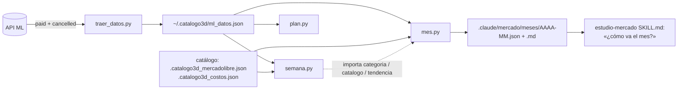

# Diseño — Ventas del mes

## Resumen

Un script nuevo, `estudio-mercado/scripts/mes.py`, hermano de `semana.py`:
lee `~/.catalogo3d/ml_datos.json`, nunca le pega a la API, y deja
`.claude/mercado/meses/AAAA-MM.{json,md}`. El cálculo es lo fácil. Lo que
ordena el diseño es que **hoy los datos no alcanzan para la mitad de los
requisitos**: `traer_datos.py` guarda solo unidades por día y por
publicación, de órdenes pagadas, fechadas en la hora de MercadoLibre. No hay
pesos, ni número de órdenes, ni canceladas, ni historial suficiente para tres
meses al mismo día. Por eso la primera mitad del trabajo es ampliar
`traer_datos.py` **sin quitar nada de lo que ya leen `semana.py` y
`plan.py`**, y la segunda mitad es `mes.py`.

## Lo que se investigó

- `traer_datos.py` pide `/orders/search` con `order.status=paid` en ventanas
  de 30 días y resume en `ventas[MLM…] = {titulo, seller_sku, variantes,
  por_dia, unidades}`. `por_dia` usa `date_created[:10]`: la fecha en el
  huso que trae ML (normalmente −04:00), no en el de la Ciudad de México
  (−06:00, sin horario de verano desde 2022). Una orden de las 23:00 en la
  CDMX queda contada al día siguiente.
- El archivo guarda `generado` y `dias_historial`, pero no `desde`. Con 90
  días bajados el 12-10, el historial arranca el 14-07, así que julio está
  incompleto y el 16-10 no se pueden armar tres meses previos al día 16.
- `semana.py` ya tiene lo reutilizable: `categoria(titulo)`, `catalogo()`
  (MLM → archivo, peso, retorno y costo del diseño) y el umbral de
  `tendencia()`. Se importa desde ahí, sin copiar.
- En el catálogo, 13 de 15 diseños tienen `retorno`, pero solo una parte de
  las ventas tiene diseño vinculado (12 de 45 unidades en W41). El retorno
  por diseño cubre poco; el estudio de mercado da un rango típico de $70–75
  por venta, en texto libre, que no conviene parsear.
- `plan.py` usa `por_dia` y `dias_historial`; con más días de historial
  sigue calculando bien porque divide por `dias_historial`.
- `.gitignore` ya ignora todo `.claude/*` salvo skills, specs,
  optimizaciones e investigación, así que `.claude/mercado/meses/` queda
  fuera de git sin tocar nada.

## Arquitectura



Todo vive dentro de skills, no en `catalog3d.py`: la galería no cambia.

## Componentes e interfaces

### 1. `colecta-full/scripts/traer_datos.py` (ampliado)

- **Fecha en la CDMX.** Una función `dia_mx(date_created)` convierte el
  timestamp con su huso a `timezone(timedelta(hours=-6))` y devuelve
  `AAAA-MM-DD`. La usan `por_dia` (ya existente) y los campos nuevos. Cambia
  levemente las cifras de `semana.py` y `plan.py` en las órdenes de cerca de
  la medianoche; es una corrección, no una regresión. Se usa un huso fijo y
  no `zoneinfo` porque no depende de que el sistema traiga la base de husos
  horarios. *(Req. 1.1)*
- **Pesos por publicación y día.** En `resumir_ordenes`, junto a `por_dia`,
  se agrega `ingreso_por_dia[fecha] += unit_price × quantity`. Es ingreso
  bruto por precio de venta: lo que pagó el comprador por el producto, sin
  envío. *(Req. 1.2, 5.1)*
- **Totales de la cuenta por día**, en un bloque nuevo al nivel raíz, porque
  una orden puede traer varias publicaciones y el conteo de órdenes no se
  puede reconstruir sumando publicaciones:
  `por_dia = {fecha: {ordenes, unidades, ingreso, canceladas}}`.
  *(Req. 1.2, 1.3)*
- **Canceladas.** Una segunda pasada de `traer_ordenes` con
  `order.status=cancelled` (el mismo código, parametrizando el estado). Solo
  se cuentan por día; no entran a `ventas` ni a `por_dia` de publicaciones,
  así que `plan.py` y `semana.py` no las ven. *(Req. 1.3)*
- **`desde`** en el JSON: el inicio real de la ventana bajada. Con eso
  `mes.py` sabe qué días tienen datos y cuáles no, en vez de confundir «no
  hubo ventas» con «no se bajó». *(Req. 1.5)*
- **`--dias` por defecto pasa de 90 a 125.** Cuatro meses y algo alcanzan
  para el mes en curso más tres previos completos hasta el día 31. Las
  ventanas de 30 días ya lo soportan. *(Req. 2.3)*

Todo es aditivo: las claves que leen `semana.py` y `plan.py` siguen ahí, con
el mismo significado.

### 2. `estudio-mercado/scripts/mes.py` (nuevo)

```
python3 mes.py                       # mes en curso
python3 mes.py --mes 2026-09         # mes cerrado, sin proyección
python3 mes.py --meta 180            # meta en unidades
python3 mes.py --meta-pesos 40000    # meta en pesos
```

Funciones puras (sin E/S) para poder probarlas con datos sintéticos:

| Función | Qué hace | Req. |
|---|---|---|
| `corte(hoy_mx, generado_mx, mes)` | Rango del análisis: del día 1 al **último día completo** con datos. Si es el mes en curso, el último día es el anterior a `generado` en la CDMX, porque el día de la descarga va a medias. El día parcial se muestra aparte como «hoy, parcial». | 1.1, 1.4 |
| `cobertura(desde, hasta, mes, n)` | Qué meses tienen los días 1..N completos dentro de la ventana bajada. | 1.5, 2.3 |
| `al_dia(serie, mes, n)` | Suma de los días 1..min(N, días del mes) de un mes, y si se recortó. | 2.1, 2.2 |
| `diferencia(a, b)` | `{unidades, pct}`, con `pct = None` si `b < 10`. | 2.4 |
| `proyectar(serie, inicio, fin, dias_mes)` | Ritmo del mes y de los últimos 7 días completos, cada uno ×días del mes; marca `cambio_ritmo` si difieren en más del 20 %; el nivel es «suposición» siempre, y «no confiable» con menos de 7 días. | 3.1–3.4 |
| `meta(objetivo, llevado, dias_restantes, ritmo)` | Faltante y ritmo diario necesario contra el actual. | 3.5 |
| `alerta(u, base, tuvo_antes, primera_venta)` | `sube`/`baja` con el umbral de `semana.tendencia` (base ≥ 2, ×1.5 con mínimo 3, o ×0.5), `dormida` si vendió el mes anterior y nada en este, `nueva` si su primera venta en la ventana cae en este mes y la ventana cubre al menos 60 días antes. | 4.3, 4.4 |
| `retorno(filas, catalogo)` | Ganancia por unidad = `retorno − costo` del diseño vinculado (vía `semana.catalogo()`). Da dos cifras: la **parcial**, sobre las unidades vinculadas (nivel «correlación»), y la **extrapolada**, que aplica el promedio de las vinculadas a las demás (nivel «suposición»). Si no hay ninguna vinculada, solo ingreso bruto y «falta el dato». | 5.1–5.4 |

`main()` carga el archivo, arma las filas por publicación y categoría (Full
según `logistic_type == "fulfillment"`, como `semana.py`), ordena por
unidades del mes, escribe el JSON y el `.md` y los imprime. *(Req. 4.1, 4.2,
4.5, 7.1)*

### 3. `estudio-mercado/SKILL.md`

- Una sección nueva, **«¿Cómo va el mes?»**, que se usa cuando el usuario
  pregunta por el mes y no por la semana cerrada. Pasos: correr
  `traer_datos.py` (si falla por sesión, seguir con lo guardado y pedir
  `login.py`, igual que en el paso 1 de hoy), correr `mes.py` y contestar
  con las 5 líneas del resumen más lo que el usuario pregunte. Sin revisar
  la competencia. *(Req. 6.3, 7.3)*
- La `description` del skill suma «cómo va el mes / ventas del mes» para que
  se dispare con esa pregunta. *(Req. 7.3)*

## Datos

### Ampliación de `ml_datos.json`

```json
{
  "generado": "2026-10-16T14:02:00+00:00",
  "desde": "2026-06-13T14:02:00+00:00",
  "dias_historial": 125,
  "por_dia": {
    "2026-10-15": {"ordenes": 9, "unidades": 11, "ingreso": 2310.0, "canceladas": 1}
  },
  "ventas": {
    "MLM123…": {
      "por_dia": {"2026-10-15": 2},
      "ingreso_por_dia": {"2026-10-15": 418.0}
    }
  }
}
```

### `.claude/mercado/meses/AAAA-MM.json`

```json
{
  "mes": "2026-10", "desde": "2026-10-01", "hasta": "2026-10-15",
  "dias_transcurridos": 15, "dias_mes": 31, "cerrado": false,
  "datos_generados": "…", "datos_viejos": false,
  "hoy_parcial": {"unidades": 3, "ingreso": 620.0},
  "totales": {"unidades": 0, "ordenes": 0, "ingreso": 0.0, "ticket": null, "canceladas": 0},
  "mes_anterior": {"al_dia": {}, "completo": {}, "recortado": false, "diferencia": {}},
  "promedio_3": {"meses": ["2026-07", "2026-08", "2026-09"], "al_dia": {}, "diferencia": {}},
  "proyeccion": {"ritmo_mes": {}, "ritmo_7": {}, "cambio_ritmo": false, "nivel": "suposición", "confiable": true},
  "meta": null,
  "retorno": {"parcial": {}, "extrapolado": {}, "unidades_vinculadas": 0},
  "categorias": {}, "publicaciones": []
}
```

### `.claude/mercado/meses/AAAA-MM.md`

1. Aviso ⚠️ si los datos son viejos o el historial no cubre lo pedido.
2. **Resumen en 5 líneas**: llevamos X; contra Y al mismo día del mes pasado
   (y contra el promedio de 3); vamos a cerrar cerca de Z (suposición); lo
   que más se movió; y la línea de «una cosa que harías», que `mes.py` deja
   como `_Recomendación: (la escribe el skill)_` porque necesita juicio,
   no aritmética. *(Req. 7.4)*
3. Totales, comparación y proyección (con nivel de evidencia en cada fila).
4. Tabla por categoría y tabla por publicación, Full / no Full, alertas.
5. Retorno: parcial y extrapolado, con su fuente.

Se sobrescribe en cada corrida del mismo mes. *(Req. 7.1)*

## Errores

| Qué pasa | Qué ve el usuario | Req. |
|---|---|---|
| No existe `ml_datos.json` | «No hay datos. Corre `python3 .claude/skills/colecta-full/scripts/traer_datos.py`» y sale con código 1. | 6.4 |
| Datos de más de 24 h | ⚠️ arriba del reporte con fecha y hora de la descarga y el comando para actualizar; el reporte sale igual. | 6.1, 6.2 |
| Archivo viejo sin `desde`, `ingreso_por_dia` ni `por_dia` raíz (bajado antes de este cambio) | El reporte sale con unidades solamente y dice «faltan pesos y órdenes: vuelve a correr `traer_datos.py`». `desde` se estima como `generado − dias_historial`. | 1.5, 6.4 |
| La ventana no cubre el día 1 del mes pedido o de los meses de comparación | Se dice desde qué fecha hay datos; la comparación que no cabe se omite con su motivo (no se rellena con ceros). | 1.5, 2.3 |
| Cero ventas en el mes | Reporte completo con «no hay ventas registradas»; ticket y porcentajes en «—». | 6.5 |
| Base del mes anterior < 10 unidades | Diferencia en unidades sin porcentaje, con «base chica». | 2.4 |
| Menos de 7 días transcurridos | Proyección marcada «suposición — todavía no confiable». | 3.3 |
| Sesión de ML vencida | Lo maneja el skill, no `mes.py` (que no toca la API): sigue con lo guardado y pide `login.py`. | 6.3 |
| `--mes` mal escrito o en el futuro | Mensaje claro con el formato `AAAA-MM`. | 1.4 |

## Pruebas

- `estudio-mercado/scripts/prueba_mes.py` con `unittest` (biblioteca
  estándar) sobre las funciones puras y datos sintéticos:
  - Día 31 contra un mes anterior de 30 días (recorte).
  - Cero ventas en el mes.
  - Base < 10 sin porcentaje.
  - Menos de 7 días → proyección «no confiable».
  - Ritmos que difieren > 20 % → `cambio_ritmo`.
  - Cobertura parcial: el mes de comparación empieza antes de `desde`.
  - `dormida` con 1 unidad el mes anterior y 0 en este.
  - Archivo viejo sin campos nuevos.
  - `dia_mx`: una orden de las 00:30 −04:00 cae el día anterior en la CDMX.
- A mano: correr `traer_datos.py` y luego `semana.py` y `plan.py` para
  confirmar que siguen funcionando con el archivo ampliado; correr `mes.py`
  para octubre y para `--mes 2026-09`, y cuadrar las unidades de septiembre
  contra la suma directa de `por_dia` del 1 al 30-09.
- `python3 -m py_compile` sobre los tres scripts tocados.

## Decisiones

| Decisión | Alternativa descartada | Por qué |
|---|---|---|
| Script en `estudio-mercado/scripts/` | Pestaña en la galería | Lo de la galería quedó fuera de alcance; el script es la base que una vista usaría después. |
| Ampliar `traer_datos.py` | Una descarga aparte para el mes | Requisito: mismo origen de datos. Una sola descarga, una sola sesión de ML. |
| Fechas en CDMX para todo, `por_dia` incluido | Solo en los campos nuevos | Dos calendarios en el mismo archivo harían que el mes y la semana no cuadren. |
| Huso fijo −06:00 | `zoneinfo("America/Mexico_City")` | La CDMX no cambia de hora desde 2022 y así no depende de la base de husos horarios del sistema. |
| Cortar en el último día completo | Contar el día de hoy a medias | Un día a medias baja el ritmo y ensucia la comparación al mismo día. |
| Importar de `semana.py` | Módulo común nuevo o copiar funciones | Son tres funciones; `semana.py` ya tiene `if __name__ == "__main__"`. Si llega un tercer consumidor, se extrae. |
| `--dias 125` por defecto | Dejar 90 y pedir más solo para el mes | El análisis del mes se pide cualquier día; con 90 el promedio de 3 meses casi nunca cabe. |
| Retorno parcial + extrapolado | Una constante de retorno típico en el código | La constante envejece y el estudio la tiene en texto libre; extrapolar del promedio vinculado se actualiza solo y queda marcado como suposición. |
| La recomendación la escribe el skill | Que `mes.py` la genere | Es juicio, no aritmética; igual que en el reporte semanal. |
