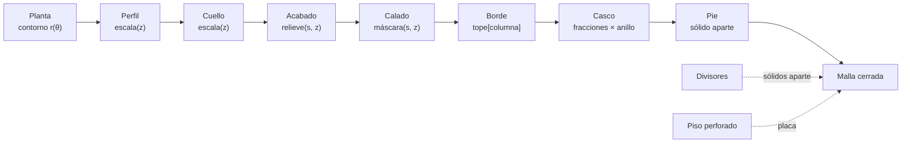

# Diseño — Vocabulario de formas

## Overview

El hallazgo que ordena todo este documento es que **tres de los cuatro ejes
nuevos caben en estructuras que el motor ya tiene**. No es suerte: el motor está
construido sobre las primitivas correctas, y lo que le falta no es arquitectura
sino vocabulario.

- **El cuello** es un factor más en `escala(z)`, al lado del perfil y del
  filete. Como va de escala y no de desplazamiento, la pared conserva su espesor
  sola, igual que con el perfil.
- **El borde** es el arreglo `tope[]`, que ya existe: el escalón lleva desde
  siempre una altura de remate por columna. Un borde recortado es escribir ese
  mismo arreglo con otra función.
- **El calado** es una máscara sobre la retícula del casco. El casco ya se arma
  como `fracciones × anillo`, una cuadrícula regular; una ventana es dejar de
  emitir celdas y coser el canto. Sin booleanos y sin retriangular.
- **El pie** es el único que pide código de verdad, y aun así reusa el idioma
  que ya usan los divisores: sólidos cerrados que se interpenetran y que el
  laminador funde.

Ese último punto merece decirse claro porque simplifica todo el diseño: los
divisores de hoy son cajas cerradas (`_loft`) que se meten dentro de la pared y
se unen con `m.unir()`. **La interpenetración de sólidos cerrados es el idioma
establecido de este motor.** El pie no necesita fusionarse con el cuerpo; le
basta con tocarlo.

Antes de escribir esto se prototipó el cuello y se renderizó. Funciona: mismo
motor, unas diez líneas, y salen jarrones. Dos cosas se aprendieron ahí y están
incorporadas abajo:

- **El motor tiene un hueco en la medición de voladizos.** Sólo mira cuando la
  pared se abre (`if r1 > r0`). Un cuello que se cierra a 57.7° —medido— no
  produce ni un aviso. Hoy es latente porque ningún perfil cierra tan fuerte; el
  cuello lo destapa el primer día.
- **La pared interior no se cruza**, ni con una hoja de punta viva cerrada al
  25%. Se probó porque parecía el riesgo obvio, y no lo es. El chequeo
  `_pared_se_cruza` que ya existe se evaluará también a la escala mínima, que
  cuesta una línea, pero como seguro y no como remedio.

## Architecture

El orden de aplicación del R7.4, que es lo que hace reproducible el catálogo:



Los tres primeros se componen multiplicando y por eso conmutan; el orden
declarado importa para la lectura y para los avisos, no para el resultado. Del
acabado en adelante sí manda el orden: el calado recorta lo que el acabado ya
puso, y el borde recorta lo que quede.

## Components and Interfaces

### Módulos nuevos

| Archivo | Aprox. | Qué hace |
|---|---|---|
| `nucleo/cuello.py` | ~90 | Familia de cuellos: `z → factor de escala` |
| `nucleo/borde.py` | ~110 | Familia de remates: `(x, y, s) → altura de la columna` |
| `nucleo/calado.py` | ~220 | Máscara de aberturas y costura de las jambas |
| `nucleo/pie.py` | ~200 | Aro de apoyo, plinto y patas, como sólidos cerrados |

### `nucleo/cuello.py`

Misma forma que `perfiles.py`, y a propósito: un cuello es un `Perfil` más.

```python
class Cuello:
    def __init__(self, fn, varia_z=True, neutro=False): ...
    def __call__(self, zn): ...     # zn de 0 a 1 → factor
```

La curva es un **smoothstep**, `s = t²(3−2t)`, entre el hombro y la boca. La
razón es exactamente el R1.3: el smoothstep tiene derivada nula en los dos
extremos, así que empalma sin esquina con la panza abajo y con la boca arriba.
Una interpolación lineal dejaría dos quiebres visibles, y una esquina en el
hombro es lo que hace que una pieza se lea barata.

```python
def suave(p):
    boca, hombro = p["boca"], p["cuello_hombro"]
    def fn(zn):
        if zn <= hombro: return 1.0
        t = (zn - hombro) / (1.0 - hombro)
        return 1.0 - (1.0 - boca) * t * t * (3.0 - 2.0 * t)
    return Cuello(fn, neutro=(boca >= 0.999))
```

Familias previstas: `ninguno` (neutro), `suave` (jarrón), `abrupto` (hombro
marcado, para lo moderno duro) y `botella` (cuello recto largo tras el hombro).

**El enganche en `cuerpo.py`** es una línea:

```python
return perfil(...) * filete(z) * cuello(min(max(z, 0.0), alto) / alto)
```

Y dos guardas alrededor:

- `capas` sube si `cuello.varia_z`, junto a las condiciones que ya existen para
  el acabado y el perfil. Sin capas, el hombro sale escalonado.
- Cuando el cuello no es neutro, `ranuras` y `filas` se fuerzan a 1 con aviso
  (R1.6). No es una restricción caprichosa: un divisor se construye cruzando la
  sección a media altura, y con la boca cerrada no hay por dónde meterlo.

**El valor neutro** (R1.7) no multiplica por 1.0: cuando `cuello.neutro`, el
factor no se compone y no se agregan fracciones. Multiplicar por 1.0 sería
exacto en coma flotante, pero las capas extra no lo serían.

### `nucleo/borde.py`

```python
def remate(p, anillo, alto) -> list[float]     # una altura por columna
```

Devuelve directamente lo que hoy calcula el bloque del escalón. Familias:
`recto`, `diagonal` (un plano inclinado, con rumbo y pendiente), `ondulado`
(coseno de `s`, con número de ondas y hondura) y `petalos` (arcos con valle
vivo).

Las frecuencias que corren a lo largo del contorno son **enteras a la fuerza**,
por la misma razón que ya obliga a eso a los acabados: el contorno se cierra
sobre sí mismo y una onda que no dé un número entero de vueltas deja un escalón
en la costura.

La composición con el escalón que ya existe es por **mínimo**: `tope[i] =
min(remate_borde[i], remate_escalon[i])`. Los dos son alturas de remate y el
material sobra donde alguno de los dos corta.

No hay problema de voladizo: el borde es lo más alto de la pieza y por debajo
siempre hay material.

### `nucleo/calado.py`

El componente con más sustancia. La idea:

```python
class Calado:
    capas_minimas: int
    def abierto(self, s, z) -> bool          # ¿este punto es hueco?
    def cerca_del_borde(self, s, z) -> float # 0..1, para desvanecer el relieve
```

El casco se arma recorriendo `fracciones × anillo` y emitiendo dos quads por
celda (exterior e interior). Con calado:

1. **Se omiten** los quads de las celdas cuyos cuatro vértices están abiertos.
2. **Se cose la jamba**: por cada arista donde una celda abierta toca una
   cerrada, se emite un quad que une el anillo exterior con el interior. Eso es
   el canto de la ventana, y es lo que deja la malla cerrada.

No hace falta booleano ni retriangulación porque la retícula ya está ahí. El
costo es que el contorno de la abertura queda **cuantizado a la retícula**: en
columnas manda `segmentos` (480 por defecto, de sobra) y en altura manda
`capas`. Por eso `Calado` declara `capas_minimas`, igual que hacen los acabados
que dibujan con la altura, y el motor avisa cuando no las tiene.

**El remate de las aberturas** es donde la física manda (R3.3). El borde
superior de un hueco es la cara de abajo del material que lo cruza: un dintel
plano es un puente horizontal y pide soportes. Dos formas válidas:

- **Ojival** (dos rectas a 45° que se encuentran en punta). Autoportante
  siempre, sin excepción, y es la que lee bohemia.
- **De medio punto** (arco de círculo). La corona es horizontal, pero es un
  puente corto y las impresoras lo hacen sin problema mientras sea corto — es
  el mismo motivo por el que un agujero redondo en una pared vertical imprime
  bien. Se permite, y **el motor mide la corona**: si el tramo a menos de 20°
  de la horizontal pasa de 8 mm, avisa y sugiere el ojival.

El borde inferior de la abertura sí puede ser plano: es la cara de arriba del
material de abajo, y por ahí no cuelga nada.

**El acabado en el borde de la ventana** (R3.7): el relieve desplaza el anillo
exterior hacia afuera, y en el canto de una abertura eso dejaría un borde
deshilachado. Se resuelve desvaneciendo el relieve a cero en el último
milímetro y medio antes del hueco, con `cerca_del_borde()`. El marco queda
limpio y la transición no se nota.

### `nucleo/pie.py`

```python
def construir(anillo, escala, p) -> (Malla | None, dict | str)
```

Misma firma que `bandeja.construir`, que ya existe y ya resuelve el mismo
problema: devolver una pieza aparte o un mensaje de por qué no se pudo.

- **Aro de apoyo** — `M.placa(contorno_exterior, [contorno_interior], 0, alto)`.
  `M.placa` ya construye un prisma con huecos, que es exactamente un aro. El
  cuerpo se levanta y el fondo queda en el aire, con sólo el aro tocando la mesa.
- **Plinto** — un `_loft` de dos secciones, la de abajo retranqueada y la de
  arriba a ras del cuerpo. Ojo con la dirección: el plinto se mete hacia adentro,
  así que el cuerpo **vuela sobre él**. Ese vuelo es una repisa horizontal, y por
  eso el plinto va de menor a mayor: la transición sube en talud. Para que el
  talud no pase de 45° hace falta `retranqueo ≤ alto`; si no se cumple, se
  recorta el retranqueo y se avisa (R2.5).
- **Patas** — de tres a seis `_loft` repartidos parejo por el contorno. Van
  colocadas **bajo la pared**, no bajo la cavidad, para que apoyen sobre
  material.

Las tres bajan exactamente a `z = 0` (R2.6): una pieza que baila es una pieza
mal generada, y el apoyo coplanar es la única forma de garantizarlo.

**Con bandeja** (R2.7): la bandeja recibe la altura del pie y la suma a su
`apoyo`. Además se comprueba que el aro no caiga justo en el hueco entre dos
costillas; si cae, se gira el reparto de las costillas.

## Data Models

Parámetros nuevos, todos declarados en `disenos.PARAMETROS` para que la pestaña
«Crear» los levante sola y la pestaña «Idea» los conozca sin tocar ningún
prompt (R7.2):

| Clave | Tipo | Rango | Grupo |
|---|---|---|---|
| `cuello` | opción | ninguno / suave / abrupto / botella | Cuello |
| `boca` | núm | 0.25 – 1.00 | Cuello |
| `cuello_hombro` | núm | 0.30 – 0.95 | Cuello |
| `pie` | opción | ninguno / aro / plinto / patas | Pie |
| `pie_alto` | núm | 2 – 40 mm | Pie |
| `pie_retranqueo` | núm | 0 – 20 mm | Pie |
| `patas` | núm | 3 – 6 | Pie |
| `calado` | opción | ninguno / ventanas / celosía | Calado |
| `calado_columnas` | núm | 2 – 24 | Calado |
| `calado_hileras` | núm | 1 – 8 | Calado |
| `calado_remate` | opción | ojival / medio punto | Calado |
| `calado_holgura` | núm | 1.5 – 20 mm | Calado |
| `borde` | opción | recto / diagonal / ondulado / pétalos | Borde |
| `borde_hondura` | núm | 0 – 0.45 (× alto) | Borde |
| `borde_ondas` | núm | 2 – 16 | Borde |
| `borde_rumbo` | núm | 0 – 360° | Borde |

Cada valor neutro es el primero de su lista, y con todos en neutro la pieza es
byte por byte la de hoy.

### Los topes que se mueven (R5)

| Parámetro | Hoy | Propuesto | Por qué |
|---|---|---|---|
| `perfil_intensidad` | 0.35 | 0.75 | El tope es de gusto, no de geometría. A 0.35 los siete perfiles siguen siendo siete tazas. El motor ya avisa del voladizo. |
| `pliegue_profundidad` | 0.16 | 0.30 | Igual: el propio README dice que de 0.10 para arriba «deja de parecer vidrio labrado». Que lo diga el aviso, no el tope. |
| `onda_amplitud` | pared − 0.4 | sin cambio para los que tallan; libre para los que sólo suman | El recorte existe para que los divisores y el piso queden embebidos. El junco no quita material, sólo pone lomos: para él el recorte sobra. |

El R5.2 obliga a que los valores de las recetas existentes no se muevan, y no se
mueven: ampliar un rango no cambia un valor.

## Error Handling

La regla del R5.1 —el motor avisa, no prohíbe— con una sola excepción: lo que es
físicamente imposible se resuelve solo.

| Situación | Qué hace | Requisito |
|---|---|---|
| El hombro se cierra a más de 45° | Avisa, diciendo cuántos grados | R1.4 |
| **La pared se abre o se cierra a más de 47°** | Avisa. Hoy sólo mide cuando se abre: el chequeo pasa a `abs(r1 − r0)` y dice en qué sentido | R6.1, R6.2 |
| Cuello con divisores | Fuerza 1 ranura y 1 fila, y lo dice | R1.6 |
| Plinto con retranqueo mayor que su alto | Recorta el retranqueo a 45° y lo dice | R2.5 |
| Patas que no apoyan sobre material | Las corre hasta la pared, o las omite y avisa | R2.6 |
| Aberturas que no dejan puente de 2 paredes | Reduce la cantidad o el tamaño, y dice qué recortó | R3.4, R3.5 |
| Calado con drenaje o bandeja | No los ofrece, y explica que la pieza no retiene agua | R3.6 |
| Calado con menos capas de las que pide | Avisa, como ya hace con el lino y el martillado | R3.3 |
| Corona de un arco de medio punto de más de 8 mm | Avisa y sugiere el ojival | R3.3 |
| Borde que baja por debajo de un divisor | Recorta el divisor y lo dice | R4.5 |
| Cualquier combinación | La malla sale cerrada, o `cerrada=False` impide guardar | R6.5 |

El aviso del voladizo bidireccional merece una nota: es un cambio en código que
ya existe y que hoy pasa por bueno un cuello imposible. Se arregla primero,
antes de agregar el cuello, para que el cuello nazca ya vigilado.

## Testing Strategy

Se extiende `generadores/pruebas.py`, que ya corre en frío con `unittest`.

**El valor neutro, que es la prueba más importante.** Para cada eje nuevo, la
pieza con ese eje en neutro debe dar exactamente los mismos vértices, triángulos
y gramos que antes de que el eje existiera. Es lo que convierte «no rompimos
nada» en algo comprobable en vez de una promesa.

**La línea base de siempre.** Las tres recetas, intactas (R7.1). Ya está escrita.

**Malla cerrada en toda la rejilla.** Un barrido combinatorio con muestreo: para
cada eje, sus valores extremos y un par intermedios, cruzados con los otros
ejes. No las decenas de miles de combinaciones, pero sí unas cuantas centenas,
y todas tienen que cerrar.

**Geometría comprobable, no sólo «no se cayó»:**

- *Cuello* — que el radio de la boca sea el pedido con menos del 2% de error;
  que la derivada del perfil sea continua en el hombro (diferencias finitas a
  ambos lados, sin salto).
- *Pie* — que todos los puntos de apoyo estén en `z = 0`; que el área de
  contacto sea la esperada; que el cuerpo no toque la mesa.
- *Calado* — que el número de aberturas sea el pedido; que la malla cierre; que
  el volumen baje al abrirlas; que ningún puente quede más angosto que dos
  paredes.
- *Borde* — que la altura máxima y la mínima sean las pedidas; que con `recto`
  la geometría sea idéntica a la de hoy.

**Voladizos.** Una tabla de siluetas con su ángulo calculado a mano, para
verificar que el medidor bidireccional acierta en los dos sentidos. Incluye el
caso medido en el prototipo: cuello de boca 0.30 con hombro en 0.80 cierra a
57.7° y **tiene** que avisar.

**Interacciones prohibidas.** Que cuello con divisores los desactive; que calado
con bandeja avise; que borde con divisores los recorte. Una prueba por regla, y
cada una comprueba también que el aviso llegó.

## CICD Integration Strategy

Lo mismo que en la spec anterior, y por la misma razón: no hay CI y no debería
haberlo. Es una herramienta local de un usuario, sin despliegue.

- `python3 -m unittest generadores.pruebas` corre en frío, sin red.
- El barrido combinatorio puede tardar; va en una clase aparte que se puede
  correr sola, para que la vuelta rápida siga siendo rápida.
- El `README.md` gana una sección por eje, en el tono del resto: qué es, por qué
  está, y qué lo hace verse caro o barato. El README de este proyecto es
  documentación de diseño, no de API, y estos cuatro ejes son justo el tipo de
  cosa que explica.
- `python3 catalog3d.py` sigue siendo el contrato de arranque.
